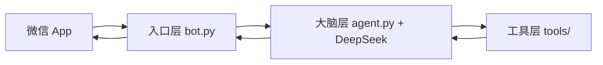
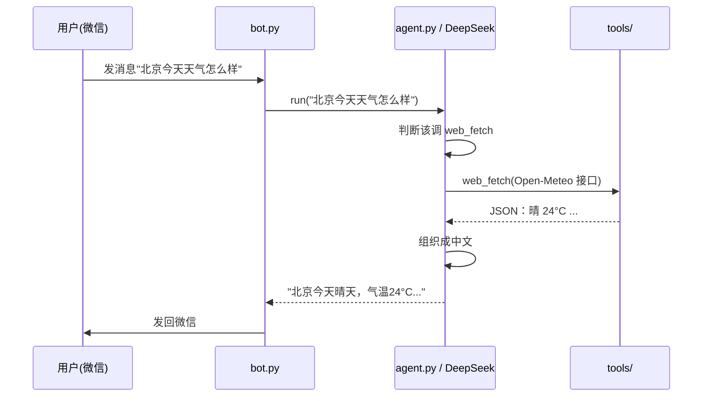
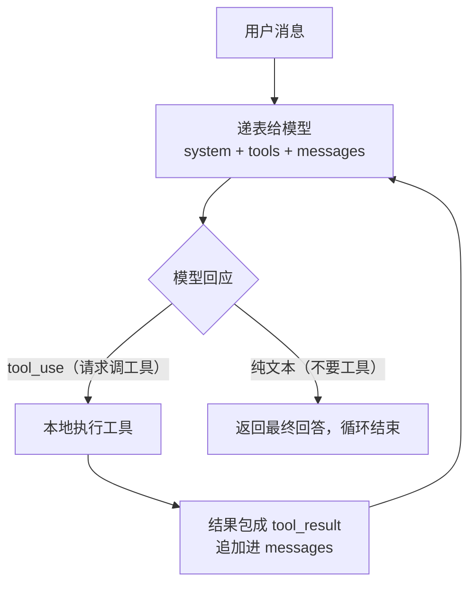
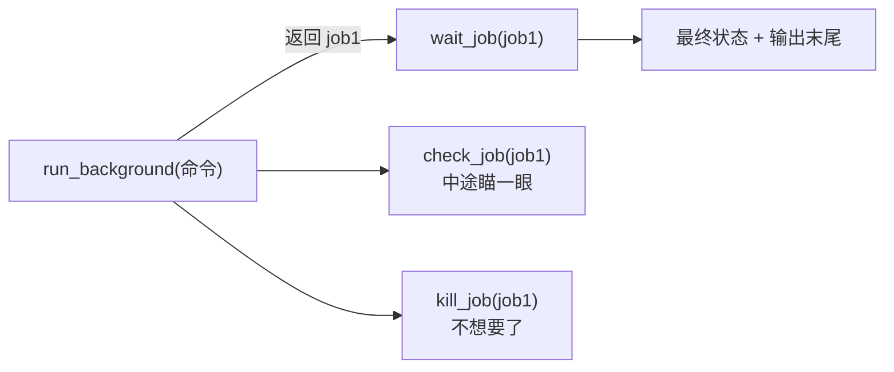

# 微信 AI Agent 项目 · 原理笔记

> 这份笔记记录了整个项目「为什么这么设计、每一层怎么工作、怎么从零搭起来」。
> 写给零基础、想彻底搞懂这个项目的自己，也方便写实验报告或答辩时直接引用。
> 配套代码：`agent.py`（大脑）、`tools/*`（工具）、`bot.py`（微信接入）、`config.py`（配置）。
> 其中 `tools/todos.py`（待办）、`tools/memory.py`（长期记忆）、`tools/mcp_client.py`（MCP）是后加的能力。

---

## 0. 一句话总纲

**微信当嘴、大模型当脑、工具当手脚，中间靠「函数调用 + 一段文字」串起来；每一层都能单独换、单独验。**

三层分别是：

| 层 | 文件 | 职责 | 换掉它影响谁 |
|---|---|---|---|
| 入口层 | `bot.py` | 收发微信消息（嘴和耳朵） | 只影响自己 |
| 大脑层 | `agent.py` + DeepSeek | 决策：该不该用工具、用哪个、怎么组织回答 | 只影响自己 |
| 工具层 | `tools/general.py`（通用工具） | 给模型基础能力（命令/文件/检索/联网），由它自己组合干活 | 只影响自己 |

> 旧版的三个专用工具（`tools/weather.py`、`calculator.py`、`scholar.py`）已**退役**，
> 文件保留作历史参考，见标签 `v1-specialized-tools`。当前版本只有通用工具。

---

## 1. 全局地图：三层解耦



一条消息的完整旅程：



**关键点：层与层之间只认一个约定**——「文字进、文字出」。

- 微信把消息交给大脑：就是喊一句 `run(文字)`。
- 大脑指挥工具：就是调用 `_exec(...)` 再转到具体工具函数。
- 所以「换平台」只动 `bot.py` 一个文件，大脑和工具一个字不用改。项目里的命令行模式 `python agent.py "..."` 就是「另一个入口」的现成证明。

---

## 2. 核心机制：工具调用循环

### 2.1 为什么需要它

大模型本身只会「说话」——知识冻结在训练那天、不能执行代码、连不上网。要给它外挂能力，有两种办法：把数据全塞进提问（笨），或者**让模型自己开口要**。项目用的是后者，这就是「工具调用」。

### 2.2 怎么转（四拍）



- **递菜单**：每次问模型时都附带一张「工具菜单」（`TOOLS`）。
- **模型决策**：它不直接编答案，而是回一个结构化的请求：`tool_use → name=web_fetch, input={"url":"..."}`。
- **代码执行**：`_exec()` 真的去跑工具函数、真的联网。
- **结果回灌**：把结果包成 `tool_result` 追加进对话，再问模型一次；模型有了真数据才给答案。

### 2.3 三个必须记牢的认知

1. **模型是「决策者」，不是「执行者」。** 它从头到尾没运行过一行代码，只是输出「我想调 web_fetch」。真正干活的是 Python。
2. **接口是无状态的，所以每轮要把历史重播一遍。** 服务器不记东西（像金鱼记忆的柜员）；「记住上下文」是客户端的事，靠不停地 `messages.append(...)` 重建整张表。推论：聊得越长，每轮越贵越慢。
3. **循环要有上限。** 没有任何机制保证模型一定会停，所以 `for _ in range(8)` 是保险丝。（旧版学术工具里「最多重试 3 次」是同一个思路。）

---

## 3. 逐行拆 `run()`

`agent.py` 的核心，二十来行：

```python
client = anthropic.Anthropic(
    auth_token=config.DEEPSEEK_API_KEY,   # 你的身份证（API key）
    base_url=config.DEEPSEEK_BASE_URL,    # 银行地址
)

def _exec(name, args):
    # 总机：模型点名哪个工具，就转到哪个函数
    if name == "run_command":
        return general.run_command(args.get("command", ""), args.get("timeout", 60))
    if name == "read_file":
        return general.read_file(args.get("path", ""), args.get("offset", 1), args.get("limit", 400))
    if name == "write_file":
        return general.write_file(args.get("path", ""), args.get("content", ""))
    if name == "edit_file":
        return general.edit_file(args.get("path", ""), args.get("old", ""),
                                 args.get("new", ""), bool(args.get("all", False)))
    if name == "multi_edit":
        return general.multi_edit(args.get("path", ""), args.get("edits", []))
    if name == "list_files":
        return general.list_files(args.get("pattern", "**/*"))
    if name == "search_text":
        return general.search_text(args.get("pattern", ""), args.get("path", "."),
                                   args.get("include", ""))
    if name == "web_fetch":
        return general.web_fetch(args.get("url", ""))
    return f"未知工具：{name}"

def run(user_text, history=None):
    messages = list(history) if history else []          # ① 准备小本本
    messages.append({"role": "user", "content": user_text})  # ② 记上用户说的话

    for round_no in range(1, MAX_TOOL_ROUNDS + 1):         # ③ 最多转 20 圈（原为 8，通用工具任务要更多步）
        resp = client.messages.create(                     # ④ 递表（唯一联网的一行）
            model=config.DEEPSEEK_MODEL,
            max_tokens=8192,                               # 写文件/改代码需要更大的输出预算
            system=_system_prompt(),                       # 岗位说明（含当前时间）
            tools=TOOLS,                                   # 工具菜单
            messages=messages,                             # 整本小本本
        )
        messages.append({"role": "assistant", "content": resp.content})  # ⑤ 模型的话也记下

        tool_uses = [b for b in resp.content if b.type == "tool_use"]    # ⑥ 挑出"想调工具"的块
        if not tool_uses:
            return "".join(b.text for b in resp.content if b.type == "text").strip()  # 出口

        results = []
        for tu in tool_uses:                              # ⑦ 挨个执行
            inp = tu.input
            if isinstance(inp, str):                      # 兜底：有的接口把参数返回成字符串
                try:
                    inp = json.loads(inp)
                except Exception:
                    inp = {}
            results.append({
                "type": "tool_result",
                "tool_use_id": tu.id,                     # 和请求配对
                "content": _exec(tu.name, inp),           # 真正干活在这里
            })
        messages.append({"role": "user", "content": results})  # ⑧ 结果也记进小本本 → 下一圈

    return "（工具调用次数过多，已停止。）"                # ⑨ 保险丝被撞
```

**几个易错点**：

- `role` 是卡片上的「署名」，只填两种：`user`（模型外面来的，包括真人**和我们的程序**）与 `assistant`（模型自己说的）。
- 工具结果为什么署名 `user`？因为协议规定：模型发出的 `tool_use` 要由「我们这一侧（user 方）」用 `tool_result` 回传。
- `resp.content` 是一串「积木」，可能是 `text` 也可能含 `tool_use`。

---

## 4. 工具层

> 当前版本的工具层只有一套**通用工具**（`tools/general.py`），详见第 10 节。
> 本节 4.2–4.5 讲的是**旧版三个专用工具**（已退役、文件保留），作为历史与教学参考。

### 4.1 一个工具的「两个身份」

一个工具本质就是个普通 Python 函数：**输入是文字，输出是文字，出错也返回文字（绝不崩程序）**。要让模型认识它，得在 `agent.py` 里上两处「户口」：

1. 菜单 `TOOLS` 里加一条（`name` / `description` / `input_schema`）——模型读 `description` 决定要不要用；
2. 总机 `_exec` 里接一根线——把工具名转到函数。

### 4.2 （旧版）算数工具：安全第一

`tools/calculator.py` 用 `ast` 把表达式解析成「运算树」再自己求值，**故意不用 `eval()`**（`eval` 会把输入当代码执行，是经典安全陷阱）。`_OPS` 是一张「白名单」：只放行认可的运算符，其余一律拒绝。

### 4.3 （旧版）天气工具：两次网络请求

`tools/weather.py` 因为天气接口只认坐标、不认城市名，所以要打两通「电话」：

1. **地理编码**：北京 → 经纬度；
2. **查天气**：经纬度 → 晴 24°C；最后用 `WEATHER_CODES` 把数字天气码翻成中文。

发请求的三要素：地址（URL）、参数（`params`）、超时（`timeout`）。拿到的是 **JSON**（接口世界的「普通话」），用 `.json()` 转成能操作的字典。

### 4.4 （旧版）学术工具：多了两个「防意外」技巧

`tools/scholar.py` 调 Semantic Scholar 的 REST API，骨架和天气一样（发请求 → 拿 JSON → 翻人话），但多了两件现实世界的生存技能：

1. **限流重试（退避）**：遇到 `429`（太频繁）或 `5xx`（对方临时坏了），先等一会儿再试，最多 3 次；尊重响应头里的 `Retry-After`。
2. **字符清理**：数据里可能混进全角空格等特殊字符，Windows 的 GBK 控制台一打印就崩，所以统一换成普通空格。

### 4.5 工具的设计哲学（三条）

- 输入输出都是文字；
- 出错返回人话（`try/except` 兜底），绝不崩程序；
- 安全上宁可笨一点（用白名单，不用 `eval`）。

---

## 5. 微信接入层（`bot.py`）

### 5.1 为什么要 openclaw：一座「桥」

微信是封闭的：它**不对个人开放**能随便让第三方程序收发消息的接口。所以「让程序接入微信」只有两条路——

- 野路子：破解客户端、往进程里注入代码（早期的 `wcferry` 方案，风险高、易封号，已放弃）；
- 正规路子：走**官方认可的机器人渠道**（openclaw-weixin 那套协议）。

**openclaw = 协议（规矩）+ 实现（按规矩做出来的程序）。** 协议本身没用（像「靠右行驶」的规则，光有规则路上没车）；真正让消息跑起来的是实现。`bot.py` 就是「照着这套现成协议，自己动手写的接入端」——它是**你的 openclaw 实现，不是你的 openclaw 协议**（好比照着 HTTP 规矩写了个浏览器，但你没发明 HTTP）。

> 说明：`openclaw-weixin` 在官方生态里的确切地位我没法打包票，但它的「角色」很清楚——一座让你合法收发微信的桥。以下描述基于项目代码与实测。

### 5.2 扫码登录：领一张「门禁卡」

登录的本质是领一张**凭证（token）**——一张「你已经授权过」的门禁卡（一串故意做成乱码的秘密字符串）。流程：


- 门禁卡 = `bot_token`；存卡的地方 = `.wcbot_session.json`（已加进 `.gitignore`，勿泄露）；
- 免扫码 = 卡还在「钱包」里，下次直接读文件；
- `--relogin` = 假装没卡，强制重新扫码（卡过期时用）。

以后每次收发消息，都在请求里亮出这张卡（`Authorization: Bearer <token>`）。

### 5.3 长轮询：一直守着等消息

- **笨办法（轮询）**：每隔几秒问一次「有消息吗」，多数白问。
- **好办法（长轮询）**：打一通电话**不挂**，有消息立刻回、没消息等约 35 秒再回，然后重拨。既实时又不浪费。

**书签（cursor）**：记录「读到哪了」，保证新消息不重不漏。每轮服务端在回信里附带一个新书签，下次带着它去。

**一直重拨费不费？** 不烧钱。这些「问消息」的请求发给腾讯，不经过 DeepSeek；只有真有人发消息触发 `run()` 才会用到（并计费于）大模型。程序关掉就停——它是跑在你电脑上的，不是云上。

---

## 6. 配置与密钥管理

### 6.1 为什么要 `.env`

密钥等「因人而异、必须保密」的东西**不能写死进代码**（代码要分享/上交，钥匙会跟着跑）。解决办法：**配置与代码分离**。

- `.env`：你的私人设置，一行一个「名字=值」，**不提交 git**；
- `config.py`：负责读 `.env`，把值取成变量供全项目使用。

```python
# config.py
import os
from dotenv import load_dotenv
load_dotenv()                       # 读 .env
DEEPSEEK_API_KEY = os.getenv("DEEPSEEK_API_KEY", "")   # 取配置，取不到用 "" 兜底
```

用法：别处都从 `config` 拿（`config.DEEPSEEK_API_KEY`），**改配置只改 `.env` 一个地方**。

**保命常识**：钥匙泄露了，去后台作废旧 key、换一把新的，更新到 `.env` 即可。

---

## 7. 从零搭建的完整顺序

心法：**从里到外、先易后难、每搭一层就验证一层。**

```powershell
# 0. 确认有 Python（3.8+）
python --version

# 1. 建项目专用「工具箱」（虚拟环境），避免不同项目依赖打架
cd C:\Users\lenovo\wechat-agent
python -m venv .venv

# 2. 照购物清单一次装齐依赖
.venv\Scripts\pip install -r requirements.txt

# 3. 把代码文件摆进目录（agent.py / bot.py / config.py / tools/ ...）

# 4. 配好 .env（填 DeepSeek key）

# 5. 先让大脑在命令行跑通——关键分水岭，不碰微信
.venv\Scripts\python agent.py "帮我算 12345*678+91"
.venv\Scripts\python agent.py "北京今天天气怎么样"
.venv\Scripts\python agent.py "查一下 Andrew Ng 的学术信息"
.venv\Scripts\python smoke_test.py     # 一次性验证三个验收点

# 6. 再接通微信（最难的一层放最后）：首次扫码
.venv\Scripts\python bot.py
# 卡失效时：.venv\Scripts\python bot.py --relogin

# 7. 在微信里给 clawbot 发那三条，有回复即全部搞定
```

**为什么这个顺序不能反？** 大脑 + 工具最好排查（在命令行里），微信最难（外部依赖多）。先在最可控的地方验证，出问题能立刻定位到哪一层。

---

## 8. 常见问题 / 排障

| 现象 | 原因 | 解决 |
|---|---|---|
| 微信里显示「暂时无法连接」 | `bot.py` 没在运行（程序关了/电脑重启了） | 重新 `python bot.py`，保持窗口开着 |
| 启动后收不到消息 | token 失效 | `python bot.py --relogin` 重新扫码 |
| 学术查询偶发失败 | 免费接口限流（429） | 稍等再试；模型会自行重试（旧版工具有内置退避） |
| 控制台打印崩溃 | 数据里有特殊字符 | 旧版学术工具已做 `_clean` 清理；新版由模型处理 |
| 「该 bot 已绑定到其它实例」 | 有另一个 bot 实例在跑 | 关掉多余实例 |

**让它一直在线**：那个窗口开着 = 在线，关掉 = 下线。

---

## 9. 关键概念速查

| 概念 | 一句话解释 |
|---|---|
| 接口（API） | 两个程序约定好的「填表递窗口」的规矩 |
| 无状态 | 服务器不记事，要办后续的活得把历史重播一遍 |
| 工具调用循环 | 递菜单 → 模型要工具 → 代码执行 → 结果回灌 → 模型给答案 |
| `role` | 卡片署名：`user`（模型外面，含程序）/ `assistant`（模型自己） |
| JSON | 不同程序交流的「普通话」，本质是排好版的文字 |
| 凭证（token） | 「已授权」的门禁卡，一串乱码状的秘密字符串 |
| 长轮询 | 打电话不挂，有消息立刻回、没消息等够再回 |
| 书签（cursor） | 记录「读到哪了」，防重复防遗漏 |
| 协议 vs 实现 | 规矩（纸面约定）vs 按规矩做出来的能跑的程序；`bot.py` 是后者的一个「openclaw 实现」 |
| 虚拟环境（venv） | 给单个项目单独准备的「工具箱」，隔离依赖 |
| 通用工具 | 给模型基础能力（命令/文件/检索/联网），让它自己组合完成任务 |

---

## 10. 通用工具：把壳从「专用」升级成「通用」（harness 底座）

### 10.1 一个常见的设计误区

最初项目按验收的三条需求，各写了一个专用工具（`get_weather` / `calculate` /
`get_scholar_info`）。这能用，但把 agent 的能力**框死了**——模型只能用你这三个工具，
别的什么也干不了。

更通用的做法是：**不给每个需求写专用工具，而是给模型一套「基础能力」，让它自己组合。**
这正是 Codex / Claude Code 这类真实 harness 的核心设计。套用上一次讲的"原子 + 通用"
——通用工具就是那块**普普通通、能拼出无穷组合的小积木**。

### 10.2 新增的通用工具（`tools/general.py`）

| 工具 | 作用 |
|---|---|
| `run_command` | 在项目目录下运行命令行命令（跑脚本、做计算、查看环境……），回传退出码与 stderr |
| `read_file` | 读文件，**返回带行号的内容**；大文件用 `offset`/`limit` 分段读 |
| `write_file` | 整体写入/覆盖；**已存在文件必须先读后写** |
| `edit_file` | 改一处：精确匹配 → 退化到"忽略行首尾空白"匹配；命中多处报错 |
| `multi_edit` | 一个文件多处改动，**原子**执行（任一处失败即整批不写入） |
| `list_files` / `search_text` | 列文件 / 全文检索（类 glob / grep），可按 `include="*.py"` 筛选 |
| `web_fetch` | 联网抓取网页文本 |

它们被登记进 `agent.py` 的 `TOOLS` 菜单、接进 `_exec` 分发器，是当前版本**唯一**注册给模型的一组工具。
`SYSTEM` 提示要求模型「自己组合通用工具完成任务」，并强制「定位 → 阅读 → 修改 → 验证」的工作流。

### 10.3 组合怎么发生

组合发生在**大脑层**，不在工具里：

- **算数** → `run_command` 跑一句 `python -c "print(...)"`；
- **查天气 / 查资料** → `web_fetch` 联网检索；
- **"项目里有哪些 .py 文件"** → `list_files`。

（实测：让 agent "用命令行算 2025*4 并列出 .py 文件"，它会自己调 `run_command` +
`list_files`；问天气则会自己用 `web_fetch` 调 Open-Meteo。）

### 10.4 专用 vs 通用：不是非黑即白

通用工具更灵活，但专用工具在三处仍更优，所以要**混合使用**，不是"只要通用"：

1. **可靠性**：抓 Google Scholar 网页会撞 CAPTCHA（本项目踩过），而调 Semantic Scholar
   API 的专用工具更稳；
2. **效率/成本**：专用工具一次调用干完，通用工具可能要模型来回几轮，更慢更贵；
3. **安全**：`run_command` 能在本机跑任意命令，通用化会放大安全面——要配套沙箱/审批。

所以真实 harness（含 Codex）都是「通用底座 + 少数高价值专用工具」，将来更多工具用
**MCP** 的方式可插拔注册。本项目当前选择了「纯通用」路线（三个专用工具退役、文件保留作历史），
旧版本见标签 `v1-specialized-tools`，追求稳定/速度时可随时切回。

> ⚠️ 安全：`general.py` 里 `run_command` 能在项目目录下执行命令，文件操作被限制在项目目录内，
> 但**不是真正的沙箱**（只有一个最粗的危险命令拦截）。请只在可信、本地环境使用。

---

## 11. 待办与提醒：从「被动应答」到「主动服务」

普通聊天机器人是"你问它才动"；待办/提醒让它**到点主动找你**，这是 agent 和聊天机器人的一个本质区别。

### 11.1 文件与工具

| 文件 | 作用 |
|---|---|
| `tools/todos.py` | 按用户读写 `todos.json`：添加 / 列出 / 完成 / 删除 / 到期检查 |
| `tools/context.py` | 记录"当前是谁在说话"，保证每个人只读写自己的待办 |

| 工具 | 作用 |
|---|---|
| `add_todo(text, due)` | 添加待办；`due` 用 ISO 时间，可空 |
| `list_todos()` | 列出当前用户未完成的待办 |
| `complete_todo(target)` | 完成指定待办（`#编号` 或内容关键词） |
| `delete_todo(target)` | 删除指定待办 |

**编号是稳定的 `#id`**，不是"第几个"——删掉别的条目也不会错位；添加后会自动把当前列表回给你。

### 11.2 时间怎么解析

系统提示里动态注入了**当前时间**：

```python
def _system_prompt() -> str:
    now = datetime.now().strftime("%Y-%m-%d %H:%M:%S")
    return SYSTEM + f"\n当前时间：{now}（Asia/Shanghai）。"
```

所以模型能把"明天早上 9 点"换算成 `2026-10-21T09:00`，再交给 `add_todo`。

### 11.3 到点怎么提醒

`bot.py` 的主循环每轮（约 35 秒）顺便检查一次：

```python
for t in due_reminders():
    send_text(sess, t["user_id"], f"⏰ 提醒：{t['text']}")
    mark_reminded(t["id"])
```

**不需要额外的定时库**——复用长轮询主循环就够了。bot 没开着时不会提醒；重新启动后会补发"已到点但没提醒过"的。

---

## 12. 长期记忆：越用越懂你

### 12.1 和多轮记忆的区别

| | 多轮记忆（对话历史） | 长期记忆（`memory.json`） |
|---|---|---|
| 保留多久 | 按 token 预算保留最近若干条，更早的压成摘要 | **一直保留**，直到你让它忘掉 |
| 内容 | 整段对话 | 你明确让它"记住"的事实 |
| 用途 | 理解"刚才那个" | 了解你的长期情况/偏好 |

### 12.2 文件与工具

`tools/memory.py` 按用户读写 `memory.json`；新增 3 个工具：

| 工具 | 作用 |
|---|---|
| `remember_fact(text)` | 记住一条关于用户的事实 |
| `recall_facts(query)` | 回忆全部 / 按关键词过滤 |
| `forget_fact(query)` | 忘掉包含关键词的记忆 |

`agent.py` 的系统提示规定：说「记住…」用 `remember_fact`；问个人情况先 `recall_facts`；说「忘掉…」用 `forget_fact`。

实测：记住「我在准备考研」后，再问「你还记得我在准备什么吗」能正确回忆。

---

## 13. MCP：给 agent 装一个「USB-C」接口

MCP（Model Context Protocol）是一套"工具插拔"的标准：外部 MCP 服务器把工具暴露出来，agent 连上就能用，**不用改核心代码**。

### 13.1 两个文件

| 文件 | 作用 |
|---|---|
| `mcp_servers/demo_server.py` | 最小 MCP 服务器，暴露 `now` / `word_count` / `random_number` |
| `tools/mcp_client.py` | MCP 客户端：后台线程跑 asyncio，把异步调用桥接成同步 |

### 13.2 同步 agent 怎么调异步 MCP

MCP 官方 SDK 是**异步**的，而我们的 `run()` 是同步的。所以：

1. 后台线程里跑一个 asyncio 事件循环；
2. `stdio_client` 启动 MCP 服务器（子进程），`ClientSession` 完成 `initialize` + `list_tools`；
3. 主线程用 `asyncio.run_coroutine_threadsafe(...)` 把 `call_tool` 丢进去，等结果。

### 13.3 怎么注册进 TOOLS

`agent.py` 启动时调用 `_init_mcp()`：

- 优先用 `.env` 里的 `MCP_SERVER_CMD`；
- 没配就用内置的 `mcp_servers/demo_server.py`；
- 把 MCP 工具转成我们的菜单格式，**统一加 `mcp_` 前缀**（如 `mcp_now`），避免和本地工具重名；
- `_exec` 看到 `mcp_` 开头，就转给 `MCPManager.call_tool`。

对模型来说，MCP 工具和普通工具**没有区别**——它只是在菜单里多看到几个工具。

> 注意：现在装的是 MCP 2.x，API 和旧教程不同（`FastMCP` 改名 `MCPServer`，工具字段是 `input_schema`）。

---

## 14. 健壮性：不死循环、不乱回、不编造

这些是"能不能稳定跑"的关键，也是答辩时的加分项。

| 机制 | 位置 | 解决什么问题 |
|---|---|---|
| 工具轮数上限 20 | `agent.py` `MAX_TOOL_ROUNDS` | 防复杂任务撞 8 轮上限 |
| 重复调用保护 3 次 | `agent.py` `MAX_REPEAT_CALLS` | 同一工具+同一参数反复重试时拦截 |
| 消息去重 | `bot.py` `seen_ids` | 同一条消息重复投递只回一次 |
| 忽略自己 | `bot.py` `from_user == bot id` | 防自回复回环 |
| 空回复兜底 | `agent.py` + `bot.py` | 模型返回空文本时给一句人话，绝不发空白 |
| 防编造 | `SYSTEM` | 工具失败/超时/空结果时如实说"服务不可用" |
| 调试开关 | `DEBUG_MSG=1` | 打印收到的原始消息，方便排查群聊字段 |
| 工具调用日志 | `run()` | 每轮记录调用了什么、参数、结果 |

**安全边界**：`.env`、`.wcbot_session.json`、`todos.json`、`memory.json` 都已加入 `.gitignore`；文件操作限制在项目目录内；`run_command` 只做了最粗的危险命令拦截——**它不是真正的沙箱**，请只在可信、本地环境使用。

---

## 15. 把「改代码」做到接近 Codex：为什么只差在工具层

老师提出的痛点是"文件处理、代码能力不如 Codex"。这里要讲清楚一个判断：**差距不在模型，而在工具层和 harness 纪律**——所以它是可修的。

### 15.1 先量一遍旧工具层的硬伤

| 硬伤 | 实测证据 | 后果 |
|---|---|---|
| `read_file` 只有 `max_chars`、没有行号、不能分段 | `agent.py` 12357 字符，只返回 8021 字符 | **文件尾部永远读不到**，大文件根本没法改 |
| `edit_file` 是裸字符串替换 | 一次误操作改了 `config.py`，它还回"已替换 1 处" | 无先读后写、无歧义保护、无失败诊断 |
| `write_file` 直接覆盖 | — | 一次误写毁掉整份文件 |
| `max_tokens=2048` | — | 写一个像样的文件就写不下 |
| `search_text` 不能按文件类型筛选 | — | 大项目里搜出一堆噪声 |
| `run_command` 超时一刀切 30s | — | 装依赖/跑测试必超时 |
| `SYSTEM` 里没有验证要求 | — | 改完不知道对不对 |

### 15.2 三个关键改造（对应三种失败模式）

**① 读不全 → 带行号 + 分段**

```python
read_file(path, offset=1, limit=400)
# 返回：  （agent.py：共 355 行，显示第 1-355 行）
#          1| """Agent 核心……
#          （还有 50 行，可用 offset=401 继续读）
```

行号不是为了好看——**模型要引用"第几行"才能精确定位改动**，人 review 时也靠它。

**② 改不准 → 三级匹配 + 歧义拒绝 + 近似定位**

`edit_file` 的匹配顺序：

1. **精确匹配**：原文在文件里唯一出现 → 直接改；
2. **忽略每行首尾空白**（fuzzy）：模型少打/多打空格也能命中，并明确告知"是按忽略空白匹配的"；
3. **命中多处 → 拒绝执行**，并列出每一处的行号，要求给出更长的唯一原文；
4. **完全没命中 → 用 difflib 算出最接近的那一行**，带行号回给模型，让它自己修正。

这就是"可纠正的失败"——**错误信息本身要能让模型下一步走对**。对比旧版只有一句"没找到要替换的原文"，模型只能瞎猜。

**③ 多改要安全 → `multi_edit` 原子执行**

一个文件改 5 处，若逐次调用，改到第 3 处失败就留下半残状态。`multi_edit` 把整批在内存里做完、**任一处不匹配就整批不写入**——要么全成，要么全不动。

**④ 防盲目覆盖 → 先读后写**

`write_file` 对已存在的文件要求："本次会话必须先 `read_file` 读过它，且读完之后它没被改动过"。这挡住了两件事：**没看内容就覆盖**、**用旧内容覆盖别人的新改动**。

### 15.3 纪律比工具更重要

工具再好，模型不用也白搭。所以 `SYSTEM` 里写死了工作流：

1. **定位** `search_text`（可 `include="*.py"`）
2. **阅读** `read_file`（大文件分段，按行号看）
3. **修改** `edit_file` / `multi_edit`（整份重写才用 `write_file`）
4. **验证** `run_command` 跑 `python -m compileall` 或测试脚本，如实回报结果

第 4 步是 Codex 和"普通套壳"最大的差别：**改完必须自己证明改对了**。

### 15.4 怎么证明它真的变强了

- `test_tools.py`：**30 项单元测试**，覆盖分段读、fuzzy 匹配、歧义拒绝、近似定位、`multi_edit` 原子性、先读后写保护、`include` 过滤、退出码/stderr 回传——不花 API 费用。
- 端到端实测：给一个有两个 bug 的 `_demo_edit.py`，模型自主完成
  `read_file` → `multi_edit`（两处原子修改）→ `run_command` 验证，
  得到 `add(2,3)=5`、`average([])=0`、`average([1,2,3])=2.0`，全部正确。

### 15.5 还没做的（诚实清单）

| 阶段 | 内容 | 为什么需要 |
|---|---|---|
| ~~Phase 2~~ | ~~结构化命令结果、后台运行/查状态/终止、`cwd`~~ | ✅ 已完成，见第 16 章 |
| ~~Phase 3~~ | ~~历史 token 预算 + 自动摘要压缩、LLM 调用重试退避~~ | ✅ 已完成，见第 17 章 |
| ~~Phase 4~~ | ~~命令执行的工作区约束、危险操作审批、审计日志~~ | ✅ 已完成，见第 18 章 |
| Phase 5 | agent 自身计划跟踪、周期定时任务 | 让它更像助理，而不只是应答器 |

---

## 16. 长任务：让命令执行"结构化 + 不阻塞"

### 16.1 旧 `run_command` 的三个硬伤

| 硬伤 | 后果 |
|---|---|
| 超时一刀切 30 秒 | 装依赖、跑测试、构建**必然超时**，agent 直接卡死在这一步 |
| stdout 和 stderr 拼在一起 | 模型分不清"正常输出"和"报错" |
| 超长输出只砍尾部（`s[:limit]`） | **报错恰恰在尾部**，最该看的信息被第一个丢掉 |

### 16.2 改造一：结构化返回

```
状态：失败（退出码 1）
[stdout]
...正常输出...
[stderr]
...错误信息...
```

模型一眼能看出"成没成、错在哪"。超长时改成 `_truncate_middle`：**保留头部 + 尾部**，中间省略——
因为头部是"开始干什么"，尾部是"最后怎么崩的"，中间大多是噪声。

`cwd` 参数还带一个约束：**必须落在项目目录内**，`cwd=".."` 会被直接拒绝。

### 16.3 改造二：后台任务（这是"长任务"的正解）

四个工具配合：



实现上是 `subprocess.Popen` + **一个后台线程逐行读输出**（`for line in proc.stdout`），
边读边把最老的丢掉（内存上限 20000 字符）。这样主线程立刻返回，agent 不会被卡住。

一个真实细节：Windows 下 `kill_job` 用 `taskkill /F /T /PID`——`/T` 是关键，
它会**连子进程树一起结束**，否则杀掉 shell 但留下 python 子进程。

### 16.4 一次实测踩出来的教训（值得记）

第一版我只做了 `check_job`（轮询），没有 `wait_job`。拿它跑一个 **sleep 5 秒**的任务，日志显示：

```
第 1 轮  run_background
第 2-4 轮 check_job → 运行中 / 运行中 / 运行中
第 6 轮  run_command {"command": "sleep 3"}      ← 模型自己想办法硬等
第 7 轮  run_command {"command": "python -c \"...time.sleep(3)\""}
第 9 轮  check_job → 已结束
```

**为了等 5 秒，白烧了 9 轮 LLM 调用。** 模型并不笨，它在给工具设计的缺陷打补丁。

补上 `wait_job`（内部就是一个带超时的轮询，最多等 600 秒）之后，同样任务：

```
第 1 轮  run_background {"command": "python _bgtest.py"}
第 2 轮  wait_job {"job_id": "job1", "timeout": 120}
```

**两轮完成。**

> 这条经验比代码本身重要：**工具设计得好不好，要看模型需不需要"绕着它想办法"。**
> 如果日志里出现模型自创的 workaround（`sleep`、反复轮询、拼字符串绕过），那通常不是模型的问题，
> 而是**该补的原子能力没提供**。

---

## 17. 上下文预算：让"记得住"和"花得起"同时成立

### 17.1 旧做法为什么不行

旧版每轮只保留**最近 20 条**消息（约 10 轮）。这是"按条数硬砍"，有两个毛病：

1. **聊久了必然失忆**：第 21 条进来，第 1 条就被扔掉——哪怕它说的是"我叫什么、我在做什么"；
2. **条数和成本没关系**：一条 5000 字的长消息和一句"你好"同样占 1 条名额。

接口是无状态的、每轮要重播全部历史，所以成本**真正取决于 token 数**，不是条数。控制变量搞错了。

### 17.2 改成"token 预算 + 摘要压缩"

```python
HISTORY_TOKEN_BUDGET = 8000   # 历史（含摘要）的预算
KEEP_RECENT_MESSAGES = 6      # 压缩时至少原样保留最近几条
```

`compact_history()` 的规则：

1. 先估算 `历史 + 摘要` 的 token；
2. **没超预算 → 一条都不动**；
3. 超了 → 把**较早的**对话喂给模型压成摘要，只留最近几条原文；
4. 摘要失败（模型挂了/超时）→ **降级为直接丢弃最老的消息**，绝不因为"压缩失败"让整轮对话崩掉。

为什么必须保留"最近几条原文"而不是全部压成摘要？因为**代词和指代靠的就是最近原文**——
"把刚才那个文件再改一下"里的"那个"，压成摘要就丢了。

### 17.3 摘要放在 system prompt，而不是塞进 messages

一个容易踩的坑：把摘要当成一条 `user` 消息插进历史里，会破坏 `user / assistant` 的交替结构，
而且模型可能把摘要当成"用户刚说的话"去回应。

所以摘要拼在 **system prompt** 末尾：

```python
text += f"\n\n以下是更早对话的摘要（供你回忆上下文，不需要复述给用户）：\n{summary}"
```

这样它永远是**背景知识**，不占消息位置，也不影响轮次结构。

### 17.4 顺带补上：模型调用重试

限流（429）、网关抖动（502/503）、超时这类失败，**重试一次基本就好了**，但旧代码一失败就整轮报错。

```python
def _create_message(**kwargs):
    for attempt in range(MAX_LLM_RETRIES):        # 最多 3 次
        try:
            return client.messages.create(**kwargs)
        except Exception as e:
            if 最后一次 or not _is_retryable(e):
                raise
            time.sleep(min(2 ** attempt * 2, 20))  # 2s → 4s → 8s
```

关键在 `_is_retryable()`：**只重试"临时性"失败**。
429/5xx/超时/连接错误 → 重试；400 参数错误、认证失败 → 立刻抛出（重试一百次也一样失败，只是白等）。

### 17.5 怎么验证（不花冤枉钱）

- `test_context.py`：**31 项**，用**替身客户端**模拟"连续两次 429 再成功"、
  "400 立刻抛出"、"重试用尽"等场景，完全不花钱；
- 压缩逻辑用**假的摘要函数**测试（验证裁剪、保留最近、多次合并、失败降级），也不花钱；
- 只对 `summarize_history` 打了 1 次真实调用，确认 prompt 和解析没问题：
  摘要输出"小吴在准备考研，目标院校是浙江大学。已定事项：每周三晚上复盘一次。"——关键事实全部保留。

> 这个思路可以推广：**能用替身验证的逻辑就别花 API 钱**，只对"真实外部行为"做少量实测。

---

## 18. 企业级可控：路径围栏、人工审批、审计日志

前三步（Phase 1-3）做的是**能力**，这一步做的是**可控**。对一个要真用起来、甚至要给别人演示的东西，
后者不能缺。

### 18.1 先承认问题：`shell=True` 等于没有围栏

`run_command` 一直是 `subprocess.run(command, shell=True, cwd=WORKSPACE)`。
`cwd` 只决定"从哪儿开始"，**完全不影响命令能走多远**——一句 `cd .. && ...`、一个 `C:\Windows\...`
就出去了。文件工具有 `_within_workspace` 拦着，命令工具却完全没有。这是最大的口子。

### 18.2 三道闸，按"后果严重程度"分层

**第一道：破坏性命令 → 永久拒绝**（不提供绕过开关）

```python
_DENY_RX = re.compile(r"rm\s+-[rf]{1,2}\s+/(\s|$|\*)|mkfs|format\s+[a-z]:|..."
                      r"|shutdown|reboot|reg\s+delete\s+hklm|chmod\s+-R\s+777\s+/")
```

这一类操作的后果不可逆、也不可能"正当需要"，所以**连审批都不给**——问用户"要不要格式化 C 盘"
本身就是个错误的选项。

**第二道：越界路径 → 拒绝（strict 模式）**

```python
def _find_escapes(command):
    # 把命令拆成 token，挑出像路径的，解析成绝对路径，看是否还在 WORKSPACE 里
```

`..`、`C:\...`、`~`、`%TEMP%`、`$HOME` 都算越界——后三种**无法静态解析**，所以宁可当作越界。

**第三道：危险但可能正当的操作 → 人工审批**

删除、移动改名、`git reset --hard`、`git push --force`、卸载包、`taskkill`、改权限、
`curl ... | bash` —— 这些**有时候确实需要做**，一刀切禁掉会让 agent 变废物。

于是做成"**默认拒绝 + 带 approve 重试**"：

```python
if _RISKY_RX.search(cmd) and not approve:
    return "deny", "这条命令属于有风险的操作，需要用户确认才能执行。\n"
                   "请先向用户说明：要执行什么、会有什么后果，并请用户明确同意；\n"
                   "用户同意后，你再带参数 approve=true 重新调用一次。"
```

**为什么这个设计特别适合聊天机器人？** 因为"审批"天然就发生在对话里：

```
模型：我要删掉 build/ 整个目录（3 个文件），删了就找不回来了，你同意吗？
用户：可以
模型：（带 approve=true 重新调用）→ 已删除
```

不需要弹窗、不需要额外 UI，**微信对话本身就是审批界面**。

### 18.3 审计日志：事后能查

```json
{"ts":"2026-10-21 11:02:03","event":"blocked","user":"o9cq...","tool":"run_command",
 "command":"rm -rf /","reason":"deny-list"}
```

每次命令、每次写文件、每次拦截、每次待审批都记一行。好处是三重的：

1. **可追溯**：出了问题能查"谁在什么时候让它干了什么"；
2. **可展示**：给老师/客户演示时，"被拦了、记下来了"比"我相信它不会乱来"有说服力；
3. **可自查**：模型自己也能调 `read_audit_log` 回答"你刚才动了我的文件吗"。

### 18.4 测试抓到的 4 个真 bug（这一段最值得看）

写完跑 `test_security.py`，**33 项里挂了 11 项**。其中 4 个是真正的设计错误：

| # | Bug | 后果 | 修法 |
|---|---|---|---|
| ① | `del /q` 里的 `/q` 被当成 Unix 绝对路径 | **所有带参数的 Windows 命令都误报越界**，agent 基本瘫痪 | `/` + 1~4 个字母视为命令行开关 |
| ② | `%TEMP%` 能被"解析"成项目内路径 | 漏检，围栏形同虚设 | 含 `%`、`$`、`~` 一律按越界处理 |
| ③ | 旧的 `_BLOCKED` 前置检查抢先返回 | `_DENY_RX` 精心写的说明文案用不上，用户看不到原因 | 删掉重复检查，只留一处判定 |
| ④ | 测试自己用正斜杠路径调 Windows `del` | 测试假失败（退出码 3） | 测试里改用反斜杠 |

**①是最典型的：安全机制本身把正常功能搞坏了。** 这类 bug 只有"跑真实的命令"才能发现——
光看代码会觉得逻辑很合理。这也是为什么安全策略**必须配一套覆盖"正常用法"的测试**，
否则很容易写成"安全到不能用"。

### 18.5 诚实边界：这不是沙箱

必须说清楚：路径围栏是**字符串层面的检查**，`shell=True` 下理论上可以用编码技巧绕过
（比如把路径拼在 Python 脚本里再执行）。真要对外提供服务，正确做法是**把命令执行放进容器或受限用户**，
这些检查只是"降低误操作概率"，不是"防住恶意攻击"。

写进文档、写在 README 里，比隐藏这一点更专业。

---

**总纲再念一遍**：微信当嘴、大模型当脑、工具当手脚，三根「函数调用 + 一段文字」的线把它们串起来；每一层可单独更换、单独验证。

**当前亮点**：通用工具 harness、对齐 Codex 的文件/代码处理能力（带行号读、原子多段编辑、先读后写、强制验证）、多轮 + 长期记忆、待办与主动提醒、MCP 可插拔扩展、工程健壮性。
